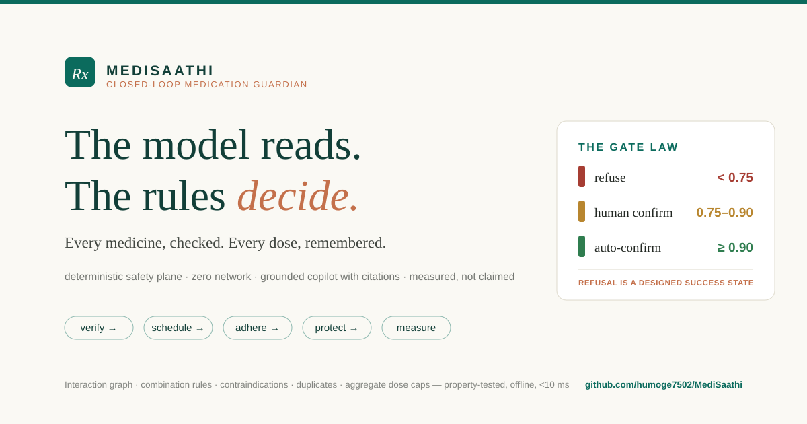

# MediSaathi · वैद्य — Agentic Medication Guardian

<p align="center">
  
</p>

**Every medicine, checked. Every dose, remembered.**

MediSaathi is a closed-loop medication-safety platform built for **VMEDITHON
V3.0** (VIT Chennai, Bio × Engineering track). It closes the loop that
reminder apps and pharmacy apps leave open:

> **verify → schedule → adhere → protect → explain → measure**

A deterministic safety engine — not the AI — decides what is safe. The AI only
reads. **When the system isn't sure, it refuses. On purpose.** That refusal is
the product working, not failing.

## Why

- Long-term therapy adherence in India sits at **16.6–24.1%**; a 2023
  meta-analysis of 2,840 patients with NCDs measured an average adherence of
  **~51%** (source recorded in `research/adherence.json`).
- Medication errors cost the world **~$42B/year** (WHO, *Medication Without
  Harm*; `research/who.json`).
- **62% of antibiotics in India are supplied without a prescription**; only
  **6–10% of adverse drug reactions** are ever reported.
- Reminder apps ping. Pharmacy apps sell. **Nothing verifies.**

## The architecture law

```
                 ┌────────────────────────────────────────────┐
Rx text / photo →│ PERCEPTION · model proposes lines + per-  │
                 │ line confidence (temperature 0, strict     │
                 │ JSON; deterministic splitter as fallback)  │
                 └──────────────────┬─────────────────────────┘
                                    ▼
                 ┌────────────────────────────────────────────┐
                 │ GATE LAW · refuse < 0.75 · human-confirm   │
                 │ 0.75–0.90 · auto-confirm ≥ 0.90            │
                 └──────────────────┬─────────────────────────┘
                                    ▼
                 ┌────────────────────────────────────────────┐
                 │ SAFETY PLANE · deterministic · zero network│
                 │ normalize → pairwise interactions →        │
                 │ combination graph (triple whammy, QT,      │
                 │ serotonin, bleeding stacks) → contra-      │
                 │ indications → duplicates → aggregate dose  │
                 │ caps → verdict (first match wins)          │
                 └──────────────────┬─────────────────────────┘
                                    ▼
              PLAN → dose schedule → adherence analytics (MPR,
              streaks, 14-day heatmap) → family escalation feed
              → grounded copilot (3 gates + citations)
              → evidence tab (live self-test + eval)
```

**The model reads. The rules decide.** If every LLM on earth vanished, the
safety plane, scheduling, adherence analytics and family circle keep working.
That is the difference between an AI wrapper and an engineered system.

## What the product does (the closed loop)

1. **Verify** — paste a prescription. An LLM reads it (per-line confidence),
   but a **deterministic safety engine decides**: interactions, combination
   rules (triple whammy, QT stacks, serotonin stacks), contraindications
   against declared context, duplicate-molecule detection, aggregate dose
   caps. Below the confidence gate it **refuses — by design**.
2. **Schedule** — a verified plan becomes a dose timeline that tells you when a
   dose is due — lead nudge, the alert, a late re-nudge, quiet hours you set — and
   a missed-dose guardrail that refuses to let anyone double up.
3. **Adhere** — check-ins build adherence %, days covered (MPR), streaks and a
   14-day heatmap. A slot whose day closed without an answer is counted as missed,
   so the figure is a history and not a reply rate.
4. **Protect** — a family circle receives timestamped escalations for late
   doses, skipped doses, and plans that started with safety findings.
5. **Review** — a **pharmacist review console** over the persisted confirm
   queue: every field the confidence gate could not auto-confirm is listed with
   the band, fused score and reason that routed it; a human confirms, corrects
   the brand, or rejects the read. While any row is pending the prescription
   **cannot** generate a therapy plan (enforced in the plan transaction, not in
   the UI), and every transition is appended to an audit trail.
6. **Explain** — a grounded copilot answers from a curated, source-attributed
   knowledge base (MedlinePlus/NIH, NHS, WHO) with three deterministic gates:
   emergency triage → scope refusal → grounded generation with citations.
   Low retrieval ⇒ refusal, not improvisation.
7. **Measure** — the in-app Evidence tab runs an 18-case engine self-test
   (no LLM, no network), a 10-case copilot evaluation with an automated rubric
   judge, and renders the **archived experiment evidence** (the A0–A4 baseline
   ladder, ablations, calibration curve and frozen operating point, parity and
   latency). What is measured is shown with its provenance; nothing is claimed.

## Repository — two tiers, one law

| Tier | Path | Role | Stack |
|---|---|---|---|
| **Product app** | `apps/web` | The demo product above — self-contained, offline-capable | Next.js 16 fullstack, TypeScript safety plane, Prisma + SQLite, bun |
| **Verification service** | `apps/api` | Deep verification: vision-LLM perception, spoken plans in en/ta/hi, Jan Aushadhi pricing, sealed-fixture judge cache | FastAPI, Pydantic contracts, SQLite WAL |

The safety plane exists in both languages (Python + TypeScript ports), each
with its own independent test suite — the law is the same, the evidence is
double.

## What is measured (not claimed)

| Benchmark | Result | Nature |
|---|---|---|
| Web engine self-test suite | **18/18 verdicts correct (100%)**, suite ~5–7 ms | Deterministic, reproducible, runs live in the Evidence tab |
| Web copilot refusal gates | emergency + scope refusals fire in ~0 ms, before any generation | Deterministic (pure regex + retrieval floor) |
| Web live degraded-tier verify | warfarin+aspirin → interaction; triple whammy → combination rule; child+doxy → contraindication; garbage → confirm queue — all **without any model** | Measured via HTTP smoke (see docs/TESTING.md) |
| Web E2E (Playwright) | **64 browser tests in 6 files**; the deterministic product tier is **47/47**: landing → verify (interaction/combination/queue/injection-inert) → pharmacist review console (queue blocks the plan, human resolves) → copilot gates → evidence (+ archived experiments) → today + dose guardrail → **reminders** (a chosen nudge is stored, survives a reload and changes the card copy; and on a `page.clock`, the 08:50 nudge, 09:00 due alert and 09:30 late re-nudge all announce and nothing further does after the dose is answered) → family (a minted join code renders exactly once and never returns) — **plus an axe-core accessibility gate** (landing, workspace, **the Today tab with a live reminders card and a resolved-dose timeline**, evidence: zero serious/critical WCAG violations, **then every one of those surfaces again in the dark scheme** — landing, Today and a one-page tour of the remaining six panels, so no workspace surface is colour-untested and the copilot tab — the one panel axe had never scored — now is; the tour was proven falsifiable by moving one dark token and rebuilding, and it failed naming `color-contrast` on all six) — **plus the placeholder gate**, which holds the panels first request open so a state that lasts milliseconds can be measured (nothing that pulses may hold text, every skeleton block sits inside `aria-hidden`, and the busy shell carries `aria-busy`) — **plus the status-message gate (SC 4.1.3)**, which stamps every `role="status"` node in the tree *before* a write and then requires the node that ends up announcing the result to still carry the stamp: the one announcement defect that cannot be caught by scanning a page at rest, because the message does not exist until a mutation makes it — **plus six theme-rendering gates** (the first animation frame of a dark-OS visit is already dark, Chromium's colour engine matches this repo's OKLCH maths to ±2/255, the served bytes put the nonced boot script above anything that could paint, a stored choice beats the OS across a reload, `prefers-color-scheme` is followed live until a choice exists, and a browser that blocks storage still hydrates with zero page errors) — **plus 14 WCAG 2.2 geometry gates** (`e2e/wcag22.spec.ts`) for the three criteria a tree-only axe scan cannot see: reflow at 320 px (the page may not scroll sideways; a table may scroll inside its own region — this found Today at 382 px and the Family relation picker at 420 px), target size 24×24 with the criterion's Inline exception honoured rather than waived (four header links measured 20 px, now 28), focus not obscured walked Tab stop by stop with a hit-test at each focused element's centre and four corners (the skip link had been skipping nothing — the sticky bar was rendered inside `#main`, and the document held two nested `<main>` elements), and the sticky bar's `scroll-padding-top` proven by where the nav anchors come to rest (top 72 against a bar ending at 65) because a Tab walk cannot see it — every one of them falsified against a broken build first, including the padding gate's first Tab-based form, which stayed green and was rewritten; the same eight axe scans also carry `wcag22aa`, so axe's own `target-size` rule — disabled by default and tag-selected here — scores every widget with the criterion's spacing allowance beside the stricter geometry reading, and the 2.5.8 gate reads all eight tag lists back out of both spec files, so a scan that silently loses the tag fails instead of passing — **plus the installable tier, 17 gates in two files** (`e2e/pwa.spec.ts`, headless, 12: the manifest the OS actually reads and the CSP a worker can actually run under are proven on the wire, a worker registers and controls the document, a handed-over queue survives every tab closing, a message stamped with another day is discarded rather than merged, a cancel empties queue and timer, an alert past the 30-minute horizon is counted rather than dropped, and **the shell opens offline while `/api/*` refuses to** — a stale plan is a plan someone could act on; `e2e/pwa-delivery.spec.ts`, headed, 5: the worker announces a real alert with **no tab open**, what it was handed is byte-identical to what the product's own law produced, an alert the worker fired is not announced twice when the page returns, and a dose answered in another window stops announcing here). Headed is not a preference — headless Chromium reports `Notification.permission === "denied"` for this origin, so it has no message centre to measure (docs/TESTING.md, "The delivery tier is split by what a browser will let it measure"). Time-independent where a browser allows it: `beforeAll` force-seeds and the seed leaves today's doses pending whatever hour the suite runs; the two gates that need a **real-clock** dose 2-180 min out skip **out loud**, with the window named in the reason, and were separately executed and passed against a dose put inside it | `make web-e2e` |
| Web accessibility, measured not asserted | the Today-tab axe scan found **two real AA failures** that review had missed: status-chip text at **3.66:1** (`taken`) and **2.52:1** (`skipped`) against their own pale tints, and a resolved list under `opacity-80` at **4.18:1** / **2.69:1**. Fixed with three hue-preserving ink tokens at **6.33 / 6.48 / 7.61**. Making the dark scheme reachable then found exactly two more, both one defect class — a token `.dark` redefines for *text* used as a *background*: the landing law band inverted to mint-on-mint at **1.05 / 1.51 / 1.08** and the `Taken` label fell to **2.35** on the lifted green. Fixed by naming the roles instead of borrowing them (`--vy-band`, a surface `.dark` must not override; `--vy-safe-on`, which dark inverts to a deep ink at **7.66**), both now pinned as laws in tests rather than as colours in a stylesheet. `apps/web/scripts/contrast.ts` recomputes every one of them offline and **reproduces axe's live numbers to 0.02**, so a contrast claim in this repo is a measurement | `bun scripts/contrast.ts` |
| Dose reminder delivery (the law, not the notification) | `planAlerts` is pure over (plan, settings, clock, delivered-set): lead nudge → due → late re-nudge, deduplicated, and **silent once the slot resolves** — including when the double-dose guardrail resolves it on the patient's behalf. Announce gate is a 60 s delivery grace on a 15 s tick, so an alert cannot be missed by a tab that woke late and cannot fire twice on a re-render. **47 + 13 tests**, plus the clock journey above | `tests/reminders.test.ts`, `tests/reminders-route.test.ts` |
| Adherence arithmetic, corrected | a dose slot whose **calendar day closed with no answer is a missed dose** (`effectiveStatus`, applied at read time — no worker, and no read route mutating the timeline), and a day that **has not arrived yet has no outcomes**, whatever its stored status. Denominator: slots whose day has closed, plus today's answered ones. `MPR` was the adherence figure computed twice; it is now **proportion of days covered** (days with every slot taken ÷ closed days) — the day-level statistic a dose-event dataset can honestly produce. Found and pinned by a **property test over 200 generated histories** recounting every published number independently; that oracle is what caught the future-day hole (seed 1, MPR 54 vs 50). Today is charged for nothing that has not happened, so the panel says the same thing at 09:00 and at 22:00 | `tests/adherence.test.ts` (25 tests, 1 853 assertions) |
| API suite | **468 tests passing** (three runs of this exact suite: 26.5 s, 26.9 s, 34.3 s — a band, not a pinned figure; the +2 over the **466** recorded 2026-10-29 is two `tests/test_dataset_manifest.py` gates, and the 36.6–43.8 s this row carried for a *smaller* 462-test suite did not reproduce — that earlier +4 having been `tests/test_verdict_tally.py`. Safety properties, golden paths, perception, red-team, parity gate, property-based invariants, observability, egress proof, FHIR export, consent stub, NLG coverage, longitudinal regimen plane, the administration-interval law, the daily-dose-cap law and its provenance, the molecule-identity law and the import gate that holds it, **the brand self-consistency gate — no catalog row keyed to a drug its own name denies**, **the evidence chain of custody — every run manifest must cite the hashes of the bytes on disk, not the hashes the last corpus build recorded, and the whole `data/reference/` tier is now inside that hash**, **the web tier's compiled table compared row-by-row against the API tier's**, **the maintained verdict tally, where an `EXPLAIN QUERY PLAN` guard fails the suite if the metrics read ever touches the row table again**, and **every sealed fixture read back out of the store** — the contract's only enforcement point. The band, not a pinned figure: three runs of the 468-test suite were 26.5 s, 26.9 s and 34.3 s, and the 36.6–43.8 s this row carried earlier was measured on a differently-loaded machine for a *smaller* suite) | `make test` |
| API fixture benchmark | brand recall 1.00 · frequency recall 0.9938 · verdict agreement **0.973** · refusal precision 1.00 (n=111). The 3 misses (RX-045, RX-088, RX-089) are **stale sealed labels**, not engine errors: each expects a verdict the curated tables do not state for the drug the strip names — recorded, not tuned away, in `docs/TECH_DEBT.md` TD-21 | `make eval` |
| API latency | three transports, same nine endpoints, n=400 with a 10-request warmup (2026-10-27). **Application work** (in-process ASGI): `GET /healthz` p50 **1.98 ms**, `POST /prescriptions` full pipeline p50 **7.5–12.0 ms**. **What a client pays** (uvicorn on a loopback port, real HTTP): `/healthz` 8.26 ms (socket floor **6.27 ms**), pipeline p50 **14.8–21.4 ms** / p95 20.3–36.7 ms. The **starlette `TestClient`** column reads 42.6–62.4 ms on the same pipeline — the per-request anyio portal, which is what every number recorded before this date was measured through, and the reason TD-25's "regression" was a harness rather than a hang. The deciding plane inside the request is **0.451 ms p50 / 2.978 ms p95** (E-F), so the safety law is not the cost at any transport | `python3 tools/bench.py --transport all` |
| Web suite (unit + route) | **509 passing** across 26 files (10 845 assertions) — verify → plan → dose guardrail → family → confirm-queue state machine → gate law → circuit breaker, plus the **status-message law** (WCAG 2.1 SC 4.1.3 as a structural gate: an *empty* live region must still be in the accessibility tree, so it collapses by height and never by `display:none`, the `hidden` attribute or an unmount — a region created in the same commit as its first message is the documented non-announcement case; `role` and `aria-live` are fixed per component, so polite-vs-assertive is two components rather than a prop flipped on a node assistive tech already registered; the set of files that *write* to the server is derived from the `post(`/`save(` call sites and pinned to its exact eight, so a ninth panel that writes without announcing fails rather than passing quietly; no panel may make its result column live, because that re-reads hundreds of words per mutation; every failure a panel can show goes to an assertive region; no `catch` block in the UI layer is empty; and the one-time caregiver join code is spoken as well as printed), the **join-code credential law** (a live code exists only in the response that mints it; every read path serializes a hint, and the test checks the serialization rather than the typed shape; the generator is rejection-sampled, not `%`-biased; no audit row stores the credential), the **ownership scope** (a `doseId` is a capability, so every route that takes a row id is refused across patients with the same text a missing row gets — no existence oracle), the **request boundary** (bounded streamed bodies, because the limiter counted requests per minute and never bytes; the ~20-model-call `/api/evals` run guard), the **deny-by-default demo reset** and its **timeline law** (today open, history closed), the **reminder law** (`planAlerts`: which alerts a plan owes, in what order, deduplicated against the delivered-set, ended by any answer, muted per medication and by quiet hours — and the route half, where the settings round-trip through the server rather than localStorage), the **worker law** (33 tests that read the *other* side of the boundary as text and compare: every constant `public/sw.js` mirrors — protocol tag, timer horizon, periodic-sync tag, day-key shape, message vocabulary, click URL — is this build's constant, so a rename on one side fails here instead of silently disconnecting delivery; the handover carries the reminder **law** rather than a second copy of the wording; a reply the page is allowed to believe is bounded by what the worker said; the sentence the card prints about delivery is walked over its whole input space and cannot overclaim; the icon's maskable geometry is *measured* from the SVG, which is how the first version was found 8 px outside the safe zone it claimed; and the headed tier's own skip boundary is pinned as a predicate, because a guard that skips on the wrong host hides five gates behind a green run), the **adherence analytics law** (a closed day with no answer is a missed dose, a day that has not arrived has no outcomes, an in-progress day is not a broken day, `null` instead of a demoralising `0%`, and MPR as days covered rather than doses taken), the **longitudinal regimen escalation** (composed harms, fragile reads, refill exemption, human-resolution release), the **administration-interval law** and the **daily-dose-cap law** (both figures a label prints, and the ceiling a declared patient condition lowers), the **molecule-identity law** (no lookup key names a retired spelling, and the copilot's retrieval meets the engine on the canonical name), the **brand self-consistency law** (all 226 repaired catalog rows compared against the compiled table the product actually loads, and the whitespace fold that makes one drug spell one way), the **generated-table invariants** (counts, recomputed table hash, fold law, combination granularity), the **public-claim gate** (every number on the landing page is re-derived from the corpus/CSV/suite it describes), the **theme law** (a stored choice beats the OS and a corrupt `localStorage` value is treated as nothing stored rather than trusted — it can never become a class name; every `.dark` override names a token `:root` declares, so a dead override fails a test; the contrast ratios are recomputed *from `globals.css` itself*, so re-tuning a colour cannot leave a documented number false; the landing band is a fixed island whose seven tokens must resolve to identical bytes in both schemes; and no app file may paint an `-ink` token as a background), the **typeface law** (the display and wordmark faces the app declares are the faces the body actually mounts, `.vy-serif` resolves through `--font-display` rather than re-picking a system serif, every wordmark that writes वैद्य carries the class that renders it in a Devanagari face, and the generated Open Graph card paints only the faces it registers and only the colours the palette still owns), proxy security contracts (including the **deploy-budget parser**: a set-but-empty `MEDISAATHI_RATE_*` is `""`, `Number("")` is `0`, and a zero write budget answers 429 to every mutation in the product — so the fallback is pinned behaviorally *and* by a structural gate that fails if `src/proxy.ts` stops reading its budgets through the guard), the copilot gates, over an isolated SQLite, perception layer sealed (no model keys needed). Suite ceiling is raised to 20 s per test (`--timeout=20000` + file-scoped `setDefaultTimeout`) because every test file shares ONE SQLite database and a first query can land on another file's WAL checkpoint | `cd apps/web && bun run test` |
| One formulary, both tiers (TD-9) | the product app no longer ships a hand-copied subset: `data/brands.csv`, `interactions.csv` and `contraindications.csv` compile into `apps/web/src/lib/safety/tables.generated.ts` — **2 836 brands / 9 660 interaction pairs / 1 267 contraindications / 583 nameable molecules**, interned into one string pool (1 719 KB instead of ~3.5 MB) and hash-pinned (`67c861f3f86dc7f7` over decision-bearing values only; the previous pin `62ea56268040d1ea` predates the catalog identity repair, which re-keyed 226 brand rows — see the brand self-consistency row below). Three gates hold it: `--check` decodes the artifact back and compares every row (`make data-check`), `test_web_dataset.py` compares it with `SafetyEngine.load()` row by row, `dataset-tables.test.ts` checks it against itself. The resolver law is now the same in both planes: exact key, else the longest key the line contains — **swept over 6 365 lines (every corpus line plus every catalog name, raw and written as "Tab …"), both planes resolve the same 6 265 lines to the same rows, 0 disagreements** | `tools/build_web_dataset.py` + `make data-check` |
| Longitudinal regimen escalation (product tier) | triple whammy assembled across two visits escalates the published verdict in the live product; the E-H fragile-read scenario (gemfibrozil active, "Ecosprin 75" read) queues instead of passing; same-brand refills pass; a human acceptance releases the plan (E-G reviewed arm) | `tests/regimen-route.test.ts` + E2E |
| Cross-engine parity (ADR-0012/MED-015) | **164/164 golden cases agree** between the TypeScript and Python safety planes, from one shared versioned corpus (parity law **v12**, `PARITY_VERSION` pinned by both runners) — every verdict-affecting rule is exercised in both tiers: the aggregate daily-dose cap, the identity merge that moved one case's verdict, combination-keyed rules (v10), the unit law for bare strengths and the IU interval mandate (v11), and frequency composition `0-0-1 weekly` (v12). Distribution: pass 36 · interaction 35 · confirm_queue 50 · contraindication 18 · duplicate_atc 16 · refused 9 | `make parity` |
| Dose-cap table of record | **one CSV, 305 molecules**, generated into both planes and hash-pinned: `data/reference/dose_caps.csv` → `apps/web/src/lib/safety/dose-caps.generated.ts` (table hash `3dc1505f75b23bdd`); a drift test fails CI if the two tiers disagree on a single number or a single context code | `tools/build_dose_caps.py` + `test_dose_caps.py` / `dose-caps.test.ts` |
| Molecule identity (ADR-0012/MED-027, TD-17) | **one drug, one name** across every table the engine reads: 11 salt/spelling aliases retired (23 brand rows, 84 interaction rows, 17 contraindication rows, 3 dose-cap rows, 2 RxNorm rows renamed; 13 interaction and 5 contraindication collisions adjudicated, each dropped row kept verbatim in `data/reference/molecule_merges.csv`). Measured effect, frozen with its definition in `data/reference/molecule_identity_reach.json`: the rules those brand rows can reach go **561 → 1,475** interactions and **38 → 72** contraindications, and the brand rows reaching a daily-dose ceiling go **0 → 23 of 23** — including the 325 mg iron ceiling that no `ferrous sulfate` brand could reach until now, which queues a 500 mg/day course in both planes | `tools/normalize_molecules.py` + `make data-check` |
| Brand self-consistency (the inverse of TD-17) | the inverse of the identity law: a catalog row may not name a drug its **own brand string** contradicts. **226 of 2 836** Jan Aushadhi rows were — `Jan Aushadhi Apixaban Tablets 5mg` filed under `warfarin`, `Jan Aushadhi Escitalopram Tablets IP 10 mg` under `citalopram` (screened against 40 mg/day while its label says 20), the 60 000 IU `Calcirol`-class sachet under `calcium carbonate` (no ceiling at all, so the IU interval mandate built for it could never fire). Re-keyed deterministically through the governed importer and recorded row by row in `data/reference/pmbjp_molecule_repairs.csv`, with the reach arithmetic frozen in `pmbjp_repair_reach.json`: addresses **17 082 → 4 238** interaction rows, **875 → 431** contraindications, **214 → 189** ceilings, and rows addressing nothing **0 → 28** — the fall is false-positive load leaving, not safety lost; the 28 are a provenance gap (TD-20), not a win. Gate says **0 of 2 836 rows contradict their own name** | `tools/repair_pmbjp_molecules.py --check` + `make data-check` |
| Evidence chain of custody | a run manifest now cites the sha256 of the **bytes on disk**, not the copy in `data/manifest.json` that only the corpus builders refresh — measured on the last stale battery, **all 11** tracked entries in the stamped record disagreed with disk while the suite stayed green. `snapshot_id` recomputes, `tools/import_snapshot.py --apply` refreshes the record in the step that replaces a table, and `make data-check` runs `tools/build_corpus.py --verify`, so a stale evidence record fails CI. The tracked set is now **22** files, not 11: the whole `data/reference/` tier sits inside the hash, and that is where the dose-cap table of record (`dose_caps.csv`, read at import by `app/safety/dosing.py`) and the QT-prolonging list compiled into both engines live — until this pass a hand edit to a cap moved no `snapshot_id` and `verify_manifest()` stayed green, the same break one directory over from the `brands.csv` repair, and the tracking rule knew `data/corpus/` by name rather than a tier by shape. Current snapshot `cbcbc470c439ffd9`. It has moved twice since the identity repair, and neither move touched a decision-bearing byte: `efa012dcfd17d32b → 7edb5bffc258d9ec` when the tracked set widened to `data/reference/` (the 11 already-hashed files are byte-identical to those cited by the 2026-10-27 run manifests), and `7edb5bffc258d9ec → cbcbc470c439ffd9` when 113 free-text cells of `rxnorm_molecule_map.csv`'s `source` column stopped naming a `tools/rxnorm_fill.py` that has never existed in this repository. The id is now derived, not retyped: `tools/check_claims.py` reads it off disk through the same `snapshot_id()` a run manifest calls, so the next data move turns this row red instead of leaving it false. None of the 83 archived run manifests cites it: 17 stamp `efa012dcfd17d32b` and the other 66 one of five earlier identities, and every one is left exactly as written, because a run manifest records the bytes *that run* read and back-dating it is the dishonesty this row exists to prevent. Corpora `cases.jsonl` n=300 digest `ee46cca6037a5eaf`, `regimen.jsonl` n=119 digest `774292e7663b246d`, both re-derived from the repaired catalog (0 verdict moves, 8 stale test-split labels corrected) | `apps/api/tests/test_dataset_manifest.py` + `make data-check` |
| A1/A4 ablation | on the same sealed 111 fixtures, verdict agreement **0.973 with the full pipeline → 0.072 without the gate, formulary and refusal band** (brand recall 1.00 → 0.982, refusal precision 1.00 → 0.982) | `make ablation` — the safety plane, not the reading, is the product |
| **Baseline ladder E-A** (300-case corpus, frozen test split n=44) | A0 agreement 0.2273 / unsafe 0.7727 · A1 0.7045 / 0.2955 · A2 0.4773 / 0.4773 · A3 0.7045 / 0.2955 · **A4 1.0000 / 0.0000** (macro F1 1.000, queue 0.250, refusal 0.045, ECE(safety) 0.1457) | `python tools/run_experiments.py --experiments E-A` |
| **Ablations E-B** (Δ vs A4) | removing the gate **−0.295 agreement / +0.295 unsafe**; removing the formulary fusion or the queue blocking **−0.250 / +0.250** each; removing the refusal band **−0.045 agreement / +0.045 queue**; removing combination logic −0.023 | `python tools/run_experiments.py --experiments E-B` |
| **Calibration E-D** | 20-point sweep, 13-point pareto frontier, **0** points with zero unsafe at ≤15% queue — the 15% burden target is **unmet and reported as unmet**; no fitted point beat the shipped default, so `v1-2026-09` stays frozen: agreement 1.000 · unsafe 0.000 (CI [0.000, 0.0803]) · queue 0.250 · ECE(safety) 0.1457 | `python tools/run_experiments.py --experiments E-D` |
| **Robustness E-C** | zero unsafe auto-confirms across 6 corruption levels (256 held-in cases mutated); invented brands never auto-confirm (0.000); queue replays refused 3/4; all stratum invariants **HOLD**. L3 brand-corruption queues 0.949 of cases and changes 0.699 of verdicts — loudly, and never toward an auto-confirm | `python tools/run_experiments.py --experiments E-C` |
| **Deterministic plane E-F** | p50 **0.451 ms** / p95 **2.978 ms** per verification over the whole 300-case corpus (budget p50<10, p95<25); offline verdict delta 0 | `python tools/run_experiments.py --experiments E-F` |
| **Human-in-the-loop E-G** | queue arm matches blanket-refusal accuracy (**1.000** vs raw 0.7045) at **5.91 s** of review per case against **26.59 s** for refusing everything — 4.5× less review time, same coverage, same accuracy | `python tools/run_experiments.py --experiments E-G` |
| **Longitudinal regimen E-H** (n=119, 84 cross-prescription) | incumbent single-prescription law catches **0.000** of cross-prescription harms (83.15% of harmful regimens pass); **regimen composition 0.905** at zero extra queue cost; **+ uncertainty propagation 1.000** at a 9.2% marginal queue cost (the 10 fragile reads), verdict agreement 0.975 | `python tools/run_experiments.py --experiments E-H` |
| API property tests | **5 safety invariants hold across ~900 generated prescriptions** (totality, gate integrity, pair symmetry, dose caps, gate monotonicity) — hypothesis finds no counterexample | `pytest apps/api/tests/test_properties.py` |
| Copilot eval (70-case harness: 10 original + 60 with adversarial/injection/Tamil/Hindi) | harness runs offline for type-routing; last model-measured run on the original 10: 100% type accuracy, groundedness 1.00, safety 1.00 (single run, automated rubric judge) | Engineering telemetry, **not** clinical validation |

Honesty rules embedded in the product: dataset provenance (DDInter / Stockley /
FDA / CredibleMeds / BMJ / WHO / NHS / MedlinePlus) is displayed wherever data
is used; refusal is a designed success state; the eval panel states it is not
clinical validation; every screen says "information layer — not a doctor".

## Research & evidence layer (patent-readiness)

The engineering above is turned into *reproducible* evidence by a research
harness whose one law is: **no number is quoted without a run manifest.**

```bash
python tools/run_experiments.py --all   # E-A..E-H -> eval/runs/ + eval/results/
python tools/export_evidence.py         # -> apps/web/src/data/evidence.json (Evidence tab)
python tools/build_binder.py            # -> docs/patent/EVIDENCE_BINDER.md
python tools/build_regimen_corpus.py    # -> data/corpus/regimen.jsonl (cross-prescription)
python tools/import_snapshot.py --kind interactions --source new_ddi.csv   # governed data updates
```

**Longitudinal regimen plane (mechanisms A+B).** The shipped law verifies one
prescription; the research plane extends it to the patient's time-composed
regimen (a triple whammy assembled across two visits, a third QT-prolonger added
later, the same molecule via a second brand) and propagates read-identity
uncertainty to a verdict distribution, forcing the confirm queue when that
uncertainty could *hide* harm. E-H quantifies both. Implemented in the Python
plane; the TypeScript mirror is the filed next step (see `docs/TECH_DEBT.md`).

- **`ml/`** — the corpus loader, baseline ladder (A0–A4) + ablations, calibration
  (ECE / Brier / reliability / threshold sweep), corruption + injection suite, and
  the human-in-the-loop simulation. Deterministic and offline.
- **`data/corpus/`** — a 300-case labeled corpus with a 70/15/15 stratified
  split, a 119-case longitudinal regimen corpus (fragile confusable stratum:
  10 cases), an annotation codebook, and sha256 manifests (`data/manifest.json`,
  snapshot `efa012dcfd17d32b`) that `make data-check` verifies against the bytes
  on disk rather than trusting.
- **`eval/runs/`** — one archived manifest per experiment run: config, dataset
  SHAs, engine commit, environment, metrics, per-case outcomes.
- **`docs/patent/`** — invention disclosure, claim concepts + strength matrix,
  normative pseudocode, experiment protocol, prior-art matrix, and the generated
  evidence binder.

**Honest limits of this evidence** (stated here, not buried): the corpus is
synthetic-curated and dual human annotation with a kappa is still outstanding
(the dual-annotator sheets + protocol + kappa tool are shipped under
`data/annotation/` ready for two pharmacists — MED-005); **its labels are
re-derived from the same curated tables the engine reads** —
`tools/build_corpus.py` builds each case from a documented rule and verifies the
assembled intent against the engine before writing it — so an E-A/E-D agreement
figure measures the plane's *consistency with its own data*, and the externally
labelled evidence is the sealed 111-fixture benchmark and the 164 hand-curated
parity lines, not the synthetic ladder;
perception accuracy on real images is a separate open experiment; the E-G
reviewer is a simulated policy, not a human panel; and the 15% review-burden
target is reported as unmet rather than redefined. Full detail in
`docs/patent/EXPERIMENTS.md`.

> ⚠️ **Disclosure pause.** The repository is public, so mechanism detail added
> after the initial push is a public disclosure. Before posting, demoing or
> publishing the gate law, fusion function, queue semantics or calibration
> numbers, read `docs/patent/README.md` and `CONTRIBUTING.md`.

## Quickstart

```bash
# Web tier (the product) — requires bun
cd apps/web
bun install
bun run db:push        # create SQLite schema (demo DB optional: Reset demo data seeds Asha's plan)
bun run dev            # http://localhost:3000

# API tier (verification service) — requires python3
make setup
make run               # http://localhost:8000/docs

# Or the whole stack in containers (verified end-to-end; see docs/DEPLOYMENT.md):
make docker                        # web :3000, API 127.0.0.1:8000 (both non-root, healthchecked)
docker compose run --rm schema     # one-shot: apply the SQLite schema to a fresh volume
```

The landing page is the pitch; **Launch app** opens the workspace. First run:
click **Reset demo data** to create Asha's demo plan with 14 days of dose
history (deterministic seed, ~79% adherence).

Demo the pipeline in 60 seconds:

```bash
# Product app (works fully offline — deterministic tier):
curl -X POST localhost:3000/api/verify -H 'Content-Type: application/json' \
  -d '{"text":"Warf 5 mg OD 30 days\nEcosprin 75 mg OD 30 days","contexts":[]}'
# → verdict: "interaction" — severe DDInter bleeding finding

curl -X POST localhost:3000/api/verify -H 'Content-Type: application/json' \
  -d '{"text":"Losar 50 mg OD 30 days\nLasix 40 mg OD 30 days\nBrufen 400 mg TDS 5 days","contexts":[]}'
# → triple whammy combination (ARB + diuretic + NSAID → AKI risk)

curl localhost:3000/api/evidence
# → 18-case engine self-test, 100% pass, dataset provenance

# API tier:
curl -X POST "localhost:8000/api/v1/prescriptions?sample_id=RX-002"
# → meta.verdict = "interaction" (warfarin + aspirin, severe, DDInter)
```

## The demo's resilience tiers

1. **Full tier** — LLM perception + grounded copilot + rubric judge (needs the model service).
2. **Degraded tier** — model unavailable: `/api/verify` falls back to a
   deterministic line-splitter and the safety plane runs at full strength
   using its own formulary-grounded confidence (verified: the warfarin,
   triple-whammy, contraindication and refusal verdicts all appear without
   any AI); the copilot honestly reports the language service is down and
   refuses to improvise.
3. **Offline tier** — engine self-test, scheduling, analytics, catch-up
   guardrails and family feed never touch the network.

The demo cannot be killed by WiFi, quota or a model outage — it *degrades
honestly, visibly, and safely*.

## Security posture

- **Deterministic safety gates** — dose-change, stop/start and emergency
  classes refuse before any generation; the double-dose guardrail is a
  first-action-wins law with audit; catch-up guidance is conservative and
  never advises doubling. The copilot sits behind a circuit breaker: a dead
  model service means fast, honest `service_unavailable` answers, never a
  30-second hang per query (recovery probes are automatic).
- **Prompt-injection containment** — perception output is inert text; the LLM
  only proposes lines, rules decide; invented brands land in the confirm
  queue (tested in both tiers).
- **Input validation** — length caps and JSON validation on every route;
  findings are rendered as text, never executed.
- **Server-side AI only** — the model SDK is imported exclusively in server
  code; no keys reach the browser.
- **Audit trail** — every verify, plan start, dose action, copilot query and
  eval run writes structured `AuditLog` metadata.
- **API tier** — request-ID correlation with injection-proof validation,
  security headers, sliding-window rate limiting (proxy-aware: a client-supplied
  `X-Forwarded-For` is trusted only behind an explicit `MEDISAATHI_TRUST_PROXY=1`),
  a 1 MiB JSON body cap (413 before the app reads a byte), upload MIME allow-list
  **plus** magic-byte sniffing, and fixture IDs hardened against path traversal
  (red-team suite: 48 tests). Structured JSON logs, per-endpoint latency SLOs
  (`/slo`, bounded windows) and a Prometheus scrape endpoint
  (`/metrics.prometheus`) — zero new dependencies, pinned by tests.
- **Web tier** — the same contract in Next.js middleware: request-ID
  correlation + per-client sliding-window limits + bounded-memory eviction on
  `/api/*`; a **nonce-based CSP** (`script-src 'nonce-…' 'strict-dynamic'` —
  no `'unsafe-inline'` for scripts), frame-deny and permissions-policy headers
  on every route;
  caregiver join codes from a CSPRNG (`crypto.getRandomValues`), never `Math.random()`.
- **Privacy by design** — no PII; single demo identity; data stays local
  (SQLite); no third-party transmission beyond the optional model prompt.

Full model: [docs/security/SECURITY_AUDIT.md](docs/security/SECURITY_AUDIT.md) and
[docs/ARCHITECTURE.md](docs/ARCHITECTURE.md).

## Tests

```bash
make test              # API suite (see the measured table above for the current count — help text has no version bump)
make eval              # API benchmark table
make ablation          # A1-vs-A4 counterfactual
make demo-check        # full offline API demo gate (sealed cases + tests + eval + python parity)
make parity            # cross-engine parity gate: both planes agree on every corpus case (needs bun; parity-py = python side only)
make claims-check      # recompute every suite count this repo quotes in a doc from a real `bun test` + `pytest` run, and fail on a drift
make experiments       # run E-A..E-G and archive a run manifest for each
make experiments-quick # fast smoke of the experiment spine
make evidence          # compile the run archive into the Evidence-tab artifact
make binder            # build the patent evidence binder from the run archive
make web-check         # web gate: lint + typecheck + selftest + parity + integration tests + build
make web-e2e           # browser E2E: build + standalone server + 64 tests in 6 files — 17 product journeys · 7 accessibility gates (5 of them axe scans) · 9 theme gates (3 dark axe scans, one a six-panel tour) · 14 WCAG 2.2 geometry gates · 17 PWA/worker tests
cd apps/web && bun run test       # route-handler integration tests (isolated SQLite) — now incl. the regimen escalation

cd apps/web && bun run selftest   # the deterministic suite, in seconds
```

CI (`.github/workflows/ci.yml`) runs all three tiers on every push/PR — API,
web and web-E2E — plus a **`container` job that builds and boots the real
compose stack and asserts what the images *contain***: no host bytecode,
database or `.env` inside either image, no Windows-or-macOS Prisma engine in the
Linux runner image, and the origin baked at build time is the origin that ships
(`docs/TESTING.md`, "Container tier, as run"). Also secret scanning (gitleaks),
Python lint (ruff), dependency audit on both stacks (`pip-audit`, `bun audit`),
and a PR-only dependency review. Jobs run least-privilege (`contents: read`).

## Engineering decisions (the interview section)

- **Why two planes?** An LLM that both reads and decides cannot be audited.
  Splitting them gives a property-tested, zero-network decision core and makes
  the model swappable without touching safety.
- **Why a deterministic safety plane in TypeScript *and* Python?** The product
  app is one-language, judge-demoable from one URL; the API tier carries the
  deep-verification features (vision, multilingual NLG, pricing). Two
  independent implementations of the same law, each with its own test suite —
  and the A1/A4 ablation proves the plane (not the reading) is what carries
  safety.
- **Why SQLite/Prisma?** The event build runs anywhere and survives demo-laptop
  restarts; the schema is Postgres-portable, and the store APIs are the
  documented swap points.
- **Why a zero-dependency BM25 retrieval?** Retrieval must be auditable and
  offline-safe in a safety-adjacent product; 30 curated chunks don't need
  embeddings. A vector index is a post-event upgrade, not a dependency.
- **Why refusal is a first-class result?** In medication, a confident wrong
  answer is worse than an honest one. Refusals are counted, displayed and
  designed — never hidden.
- **Why contracts/envelope discipline?** Typed end-to-end; the frontend cannot
  silently drift from the backend.
- **Why is the web dependency tree tiny?** The scaffold shipped ~40 Radix/UI
  packages and an editor/carousel/DnD stack; a grep-driven prune kept only what
  is imported (Prisma, Next, the toast/button primitives, the model SDK) —
  827 → 170 packages. Unused dependencies are attack surface and install-time
  friction dressed up as features.- **Why CSS animations instead of framer-motion?** The motion budget is a
  few fade/stagger entrances and hover transitions; CSS handles that with zero
  runtime cost, and `prefers-reduced-motion` is honored in the same file that
  defines the animation. A JS animation library would earn nothing here.
- **Why does the regimen escalation only ever escalate from a `pass`?** The
  single-prescription law already routes every harmful verdict through the
  finding/queue state machine; the regimen layer exists to catch what that law
  structurally cannot see — harms composed across prescriptions and read
  uncertainty that could hide them. Layering the escalations (instead of
  merging the planes) keeps the shipped law bit-for-bit and the ablation
  evidence valid. Refills (the same brand re-verified) are exempt: composing
  a plan with itself is a refill, not a harm.
- **Why a nonce CSP now?** `'unsafe-inline'` for scripts was the one
  defense-in-depth gap the middleware left. A per-request nonce +
  `'strict-dynamic'` closes it; the cost is dynamic rendering of document
  routes (the landing page is tiny and engine-free, so the trade was easy).
- **What I would scale next?** Postgres, Redis limiter, OTP + ABDM-style
  consent, a labeled 300-case corpus with versioned DDInter/RxNorm snapshots,
  and a pharmacist review console over the (already persisted) confirm queue.

## Documentation map

| Doc | What's inside |
|---|---|
| [docs/BLUEPRINT.md](docs/BLUEPRINT.md) | evidence → concepts → architecture → execution record for the closed-loop build |
| [docs/ARCHITECTURE.md](docs/ARCHITECTURE.md) | both tiers, the two-plane law, data flows, ADR table, FMEA |
| [docs/DEMO_SCRIPT.md](docs/DEMO_SCRIPT.md) | 4-minute judge walkthrough + contingency drills |
| [docs/RESEARCH.md](docs/RESEARCH.md) | problem, hypothesis, method, measured results, limitations |
| [docs/TESTING.md](docs/TESTING.md) | test pyramid, red-team table, web regressions fixed with evidence |
| [docs/PERFORMANCE.md](docs/PERFORMANCE.md) | measured latency + bundle numbers, budgets |
| [docs/security/SECURITY_AUDIT.md](docs/security/SECURITY_AUDIT.md) | threat model, controls, honest gaps |
| [docs/TECH_DEBT.md](docs/TECH_DEBT.md) | open debt ledger + resolved-with-tests record |
| [docs/HACKATHON_STRATEGY.md](docs/HACKATHON_STRATEGY.md) | judged scorecard, demo path, judge-attack Q&A |
| [docs/BUSINESS_MODEL.md](docs/BUSINESS_MODEL.md) | who pays and for what, the data-licence gate that precedes revenue, unit economics from the measured latencies, pilot-readiness gaps, gates instead of dates |
| [docs/DEPLOYMENT.md](docs/DEPLOYMENT.md) | both tiers, env vars, secrets, DB/migrations, monitoring, rollback |
| [docs/audit/REPOSITORY_AUDIT.md](docs/audit/REPOSITORY_AUDIT.md) | full repository audit (pre-integration state + addendum) |
| [docs/product/PRODUCT_STRATEGY.md](docs/product/PRODUCT_STRATEGY.md) | personas, JTBD, differentiation, roadmap |
| [docs/research/COMPETITIVE_ANALYSIS.md](docs/research/COMPETITIVE_ANALYSIS.md) | feature matrix vs Medisafe/Tata 1mg/etc. |
| [research/](research/) | literature review + references, novelty analysis, experiment protocol |
| [docs/patent/](docs/patent/) | **patent evidence package**: invention disclosure, claim concepts + strength matrix, normative pseudocode of the gate/fusion/precedence/queue laws, experiment protocol + results, prior-art matrix, and the generated evidence binder |

## Repository layout

```
apps/api            FastAPI verification service (pipeline, verdicts, plan, price, ADR, judge, upload)
apps/web            Next.js 16 fullstack product app (verify·today·insights·copilot·family·evidence)
  └ src/lib/safety  deterministic TS safety plane (dataset, engine, adherence, reminders, regimen, selftest)
  └ src/lib/ai      gated AI layer (extraction, retrieval, copilot, evals)
  └ prisma/         longitudinal schema (9 models, provenance-preserving)
packages/contracts  Pydantic v2 contracts — the API tier's single source of truth
data/               API seed CSVs, fixture corpus, cases manifest, eval labels, sources
eval/               API benchmark CLI (A1/A4 ablation, recall/agreement/precision/latency)
tools/              demo-check gate, judge-cache baker, latency bench
e2e/                web E2E suite (apps/web/e2e) — Playwright, deterministic tier only
docs/               architecture, blueprint, testing, security, strategy, audit, research
research/           literature review, references, novelty analysis, experiment protocol, recorded sources
```

## Honest limits (read before judging us)

- **Scope** — perception reads pasted/typed text; the API tier's photo path is
  live and key-gated (the demo default is the deterministic corpus so the
  walkthrough cannot fail on quota or WiFi).
- **Data** — curated demo corpus with recorded per-rule sources; production
  swaps in versioned DDInter/RxNorm/DailyMed snapshots. No statistics are
  fabricated in-product.
- **Auth** — event build is single-patient demo scope; caregiver links are
  code-based views, not authenticated accounts.
- **Not a doctor** — information layer only; not a medical device; not
  clinical validation. In an emergency, contact local emergency services.

## License

Code: MIT. Curated datasets: CC-BY 4.0 with recorded sources
(`apps/web/src/lib/safety/dataset.ts` header, `data/sources.json`).
Typefaces: Fraunces and Rozha One, both SIL Open Font License 1.1, shipped
unmodified as the static instances the Open Graph card renders
(`apps/web/src/app/fonts/`, licence text beside each file).